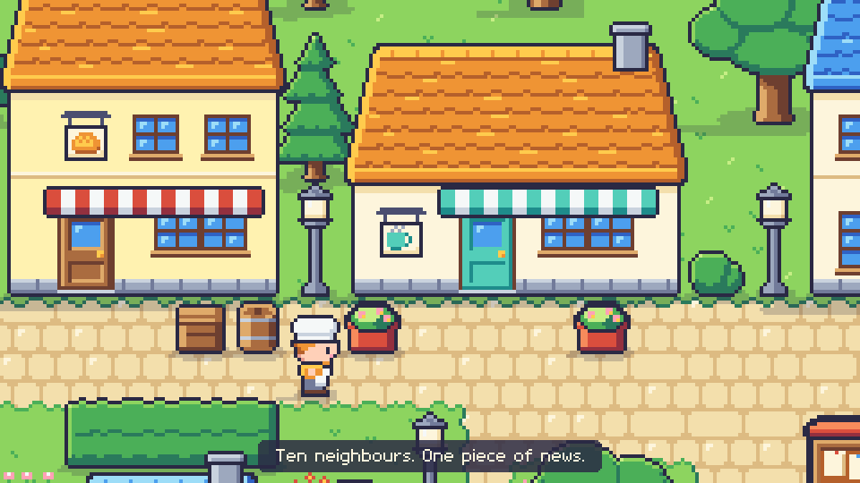
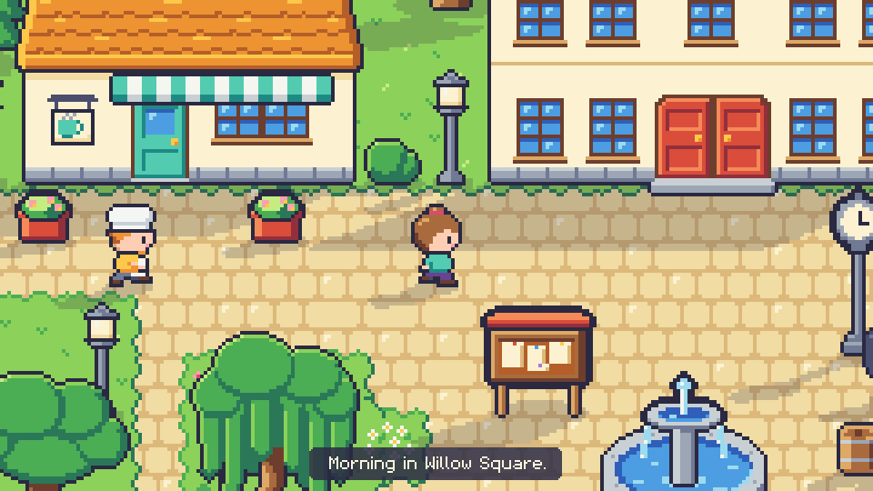
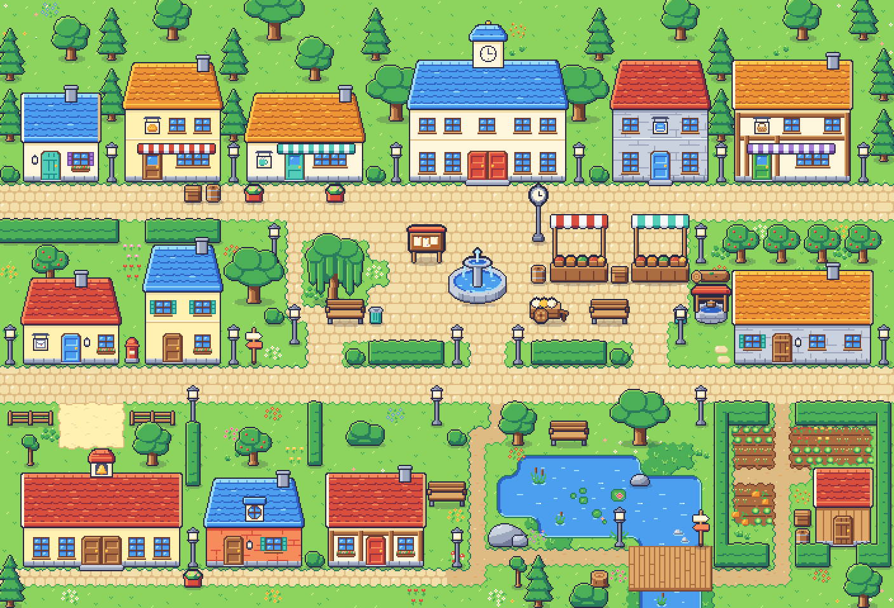
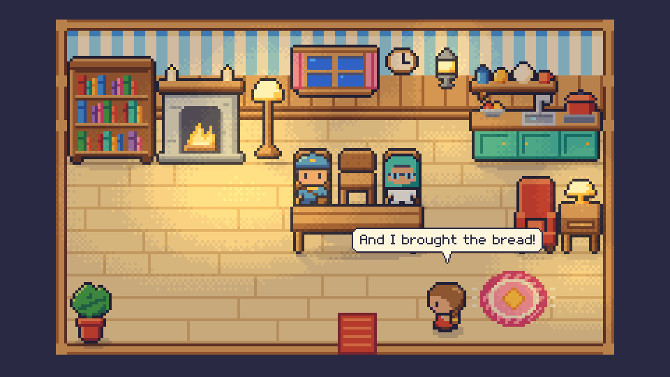
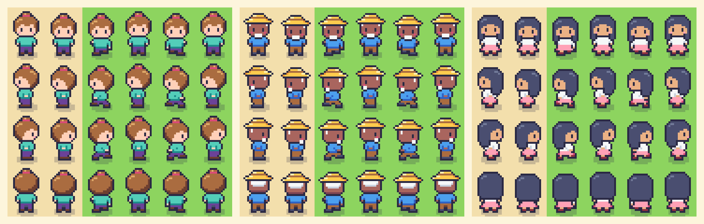
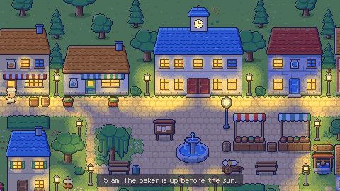
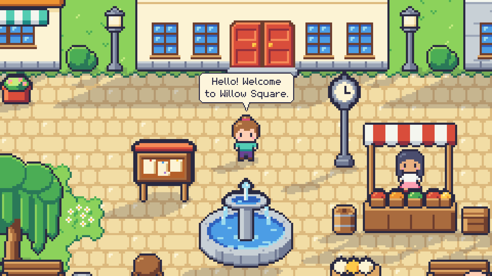
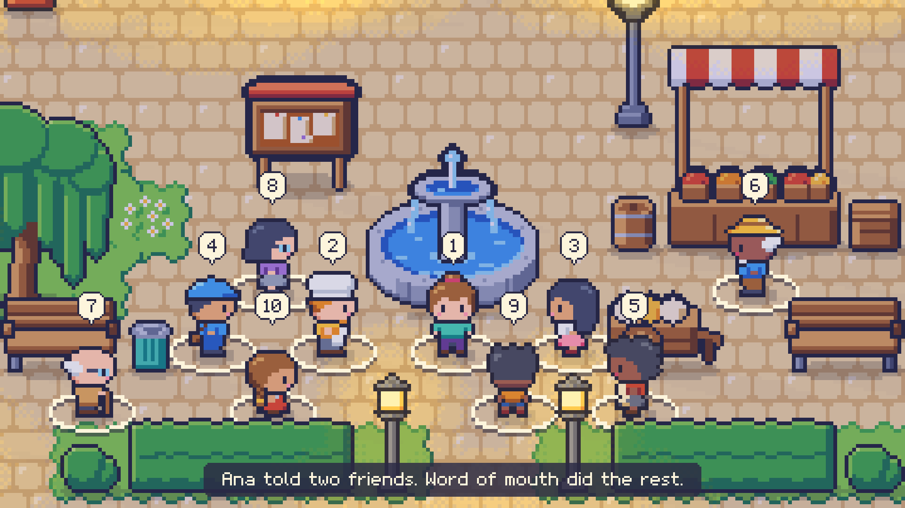
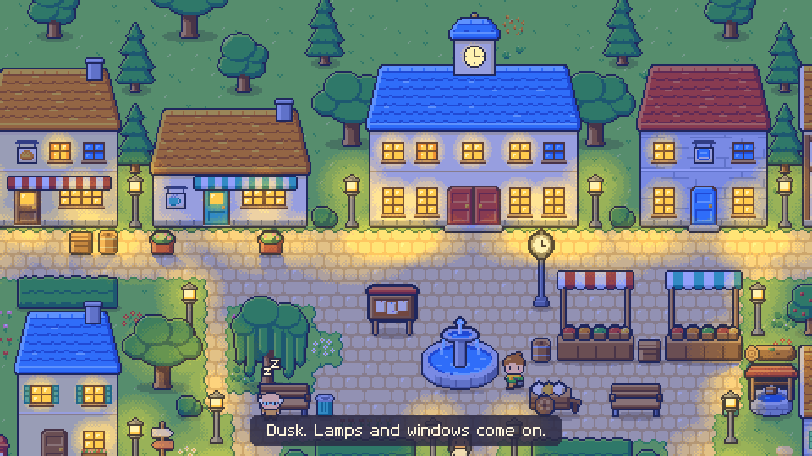

# Simutown

Simutown is a toolkit for scripting small pixel-town scenes that explain ideas: you write a short script in TypeScript, and townspeople walk, talk and pass things on in a film you can play in a browser or render to video.
Think of [manim](https://www.manim.community/) for a little town of people, inspired by the Smallville sandbox of Park et al. (2023), with no language models inside: the author of the scene decides what happens.



**Status: early.** It works, and the scenes on this page are rendered with it, but the API may still change.

## Quickstart

You need [Node.js](https://nodejs.org/) (tested with version 24), [pnpm](https://pnpm.io/), and [ffmpeg](https://ffmpeg.org/) on your path for video.
To try it, clone the repository, then:

```bash
pnpm install
pnpm simutown render hello     # writes out/hello.mp4, 1920x1080
pnpm dev                       # the gallery, at http://localhost:5173
```

The gallery plays every scene in `scenes/`, with a scrub bar, and has an Atlas of all the art with the ids you type in a script.



## Install in your own project

To write scenes in a project of your own, install Simutown from GitHub; it builds itself on the way in.
You need Node.js 22.18 or later, and ffmpeg for video.

```bash
npm install github:vdcmathieu/simutown
pnpm add github:vdcmathieu/simutown
```

pnpm 10 and later build a dependency from git only once you allow it: the first `pnpm add` stops and prints an `allowBuilds` entry; add it to `pnpm-workspace.yaml` and run the command again.

The package comes with the `simutown` command (`npx simutown`, or `pnpm simutown`):

```bash
npx simutown new market-day              # a commented starter scene in scenes/, or in this folder if there is no scenes/
npx simutown info market-day --beats     # build it, and list when each walk, line, caption and camera move starts
npx simutown still market-day -t 4       # one frame as a PNG, out/market-day-4s.png
npx simutown render market-day           # the film, out/market-day.mp4
```

A scene imports the library by name:

| Import | What it has |
|---|---|
| `simutown` | The engine, safe in a browser: `scene`, `defineTown`, `describeTown`, the renderer, the built-in art and town, and the kits `makeCharacter` and `makeBuilding`. |
| `simutown/towns` | The built-in towns: `willowSquare`. |
| `simutown/player` | `mount`, which plays a scene in a web page. |
| `simutown/node` | `renderVideo`, `renderStill` and `writePNG`, to render from your own Node scripts. |

The types come with it, for TypeScript set to `"moduleResolution": "bundler"` or `"nodenext"`.
Node runs a `.ts` scene file as it is, by erasing its types, so a scene imports types with `import type` and writes relative imports with their extension (`./my-town.ts`; TypeScript accepts that with `allowImportingTsExtensions`).
A scene can also be a plain `.js` file.
A scene is an ES module.
In a project whose `package.json` says `"type": "module"`, `simutown new` writes a `.ts` file; in any other project it writes `.mts`, which Node reads as an ES module whatever the project is.
The command treats the folder of the nearest `package.json` above where you run it as the project: `scenes/` and `out/` are looked for there.

## A complete scene

A scene is one TypeScript file.
This one defines a small town inline, puts two of the townsfolk in it, and has them say good morning:

```ts
// examples/good-morning.ts - the smallest complete scene: a town, two people, a few lines.
import { defineTown, scene } from 'simutown';

// A lane between two lawns: a bakery on the north side, a bench and a tree on the south.
const lane = defineTown({
  name: 'Bakery Lane',
  terrain: `
    gggggggggggggggggggggggggggggg
    gggggggggggggggggggggggggggggg
    gggggggggggggggggggggggggggggg
    gggggggggggggggggggggggggggggg
    gggggggggggggggggggggggggggggg
    gggggggggggggggggggggggggggggg
    gggggggggggggggggggggggggggggg
    cccccccccccccccccccccccccccccc
    cccccccccccccccccccccccccccccc
    cccccccccccccccccccccccccccccc
    gggggggggggggggggggggggggggggg
    gggggggggggggggggggggggggggggg
    gggggggggggggggggggggggggggggg
    gggggggggggggggggggggggggggggg
    gggggggggggggggggggggggggggggg
    gggggggggggggggggggggggggggggg
    gggggggggggggggggggggggggggggg
  `,
  legend: { g: 'grass', c: 'cobble' },
  props: [
    { kind: 'bakery', at: [12, 6] },
    { kind: 'lamp', at: [10, 6] },
    { kind: 'bench', at: [16, 10] },
    { kind: 'tree', at: [20, 11] },
  ],
  places: { west: [2, 8], east: [27, 8] },
});

export default scene({ title: 'Good morning', town: lane, timeOfDay: 9 }, (s) => {
  const ana = s.actor('ana', { at: 'west', facing: 'right' });
  const bo = s.actor('bo', { at: 'bakery.door', facing: 'down' });

  s.camera.cut('bakery.door', { zoom: 2 });
  s.fadeIn();
  s.caption('Every morning, Ana passes the bakery.');
  ana.walkTo(bo);
  ana.say('Good morning, Bo!');
  bo.say('Morning, Ana. Fresh bread today.');
  ana.emote('heart');
  s.clearCaption();
  s.wait(0.5);
  s.fadeOut();
});
```

```bash
pnpm simutown render examples/good-morning.ts -o out/good-morning.gif
```


The script reads like a screenplay: each call takes its time and the next one starts when it ends.
Walking finds its own path around buildings, a speech bubble stays up long enough to read, and the same script always gives the same film, frame for frame.

## What is in the box

**A town.** Willow Square (`src/towns/willow-square.ts`) is the town the example scenes are set in, ready to use in yours.
Its doorways and corners have names such as `cafe.door`, which a script uses as targets, and `describeTown` prints them all.



**Rooms.** Every building with a door but the shed has an inside: the bakery with its oven and counter, the cafe, the school, the library, the town hall, the shop, the post office and five homes, each furnished for who lives there.
People go in and out with `enter` and `exit`, the camera follows them through the door, and in the evening the lamps and the fire light the room.
The `fresh-bread` scene goes from the bakery to a family's supper table.



**A cast.** Fourteen townsfolk, each with a role and a look: Ana the neighbour, Bo the baker, Yuki the teacher, Kofi and Lin the children, Otto the elder, Raj the postal worker, and more.
Each walks in four directions, sits, waves, talks and carries, and shows emotes (a heart, an idea, a question mark, ...).
The [authoring guide](docs/authoring.md#3-cast-from-the-townsfolk) lists them all.



**The kits.** Make new people with `makeCharacter` (body, skin, hair, hat, clothes, accessories), new buildings with `makeBuilding` (width, storeys, wall, roof, door, windows, sign, awning, turrets), and anything else as a sprite drawn as a text grid.
Everything follows one [art direction](docs/STYLE.md), so new art looks like it belongs.

**The moods.** Set the hour of a scene, or animate it: morning light, plain daylight from nine to four, a golden late afternoon, a pink sunset, a blue evening and a night lit by lamps and windows.



**The teaching overlays.** Captions, title cards, labels above people, dotted links that show information passing, rings, and a focus that dims everyone else.

**Example scenes** in `scenes/`, to read and to copy: `hello`, `word-of-mouth`, `day-and-night` and `fresh-bread`.

| `hello` | `word-of-mouth` | `day-and-night` |
|---|---|---|
|  |  |  |

## Writing your own scene

Put a `.ts` file in `scenes/` that default-exports a `scene(...)` (`pnpm simutown new my-scene` writes a starter), then:

```bash
pnpm simutown info my-scene            # builds it: duration, places, cast, or the error
pnpm simutown info my-scene --beats    # and when each walk, line, caption and camera move starts
pnpm simutown still my-scene -t 4      # one frame at 4 seconds, out/my-scene-4s.png
pnpm simutown render my-scene          # out/my-scene.mp4
pnpm simutown render my-scene -o out/my-scene.gif
```

Mistakes throw when the scene is built, with the valid names and a guess: `Unknown place "cafe.dor". Did you mean "cafe.door"?`.

- [Writing a scene](docs/authoring.md): from an idea to a film, with a worked example, pacing rules and a checklist.
- [The scripting API](docs/scene-api.md): every call, with its timing.
- [Making art](docs/making-art.md): new townsfolk, buildings, props and grounds.
- [The art direction](docs/STYLE.md): the rules every sprite follows.

## Embedding a scene

**In slides.**
`pnpm simutown render my-scene` writes an H.264 MP4 at 1920x1080: drop it into Keynote or PowerPoint, or insert it into Google Slides from Drive.
A `.gif` works where video does not.
HTML slides (reveal.js and the like) can embed the live player with an iframe, as below.

**In a web page, with an iframe.**
`pnpm build:web` writes the gallery to `dist/web/`, a static site you can host anywhere.
Every scene in `scenes/` is then playable on its own at `?embed=<name>`:

```html
<iframe src="https://example.org/simutown/?embed=word-of-mouth" width="960" height="580" style="border: 0"></iframe>
```

Add `&autoplay=0`, `&controls=0` or `&loop=0` to change how it starts.
`pnpm preview` serves `dist/web/` locally to try it.

**In a web page of your own.**
The player is one function, `mount`, which draws the scene into a canvas inside any element.
With a bundler such as Vite, import it and the scene:

```html
<!-- examples/embed.html (excerpt) -->
    <div id="stage"></div>
    <script type="module">
      import { mount } from 'simutown/player';
      import scene from './good-morning';

      const player = mount(document.getElementById('stage'), scene, { autoplay: true, loop: true });
      // player.pause(); player.seek(3); player.play(); player.destroy();
    </script>
```

`pnpm vite examples` serves that page at http://localhost:5173/embed.html.

## Asking a coding agent to write a scene

Simutown is built to be scripted by coding agents as well as by people.
[`AGENTS.md`](AGENTS.md) tells any agent (OpenAI Codex reads it) how to write, check and render a scene, and Claude Code also loads the `simutown-scene` skill in [`.claude/skills/`](.claude/skills/simutown-scene/SKILL.md).
Open the repository in your agent and ask for the scene in a sentence:

> Write and render a 30-second scene in which Yuki explains to Kofi and Lin why the pond freezes from the top down.

> Make a scene for my lesson on network effects: one person in the square starts using a new noticeboard, and more join each day.

The agent finds the places with `describeTown`, casts from the townsfolk, renders stills to check its work, and renders the film.
Ask it for the stills too: they are the quickest way to review a scene.

## Credits

Simutown is inspired by the Smallville sandbox of:

> Joon Sung Park, Joseph C. O'Brien, Carrie J. Cai, Meredith Ringel Morris, Percy Liang, and Michael S. Bernstein. 2023. Generative Agents: Interactive Simulacra of Human Behavior. In *Proceedings of the 36th Annual ACM Symposium on User Interface Software and Technology (UIST '23)*. ACM. https://doi.org/10.1145/3586183.3606763

The idea of scripting explanations as code comes from [manim](https://www.manim.community/).
All the art in Simutown is original and drawn in code, as text grids of palette colours; none of it is taken from any game.

## Licence

MIT. See [LICENSE](LICENSE).
