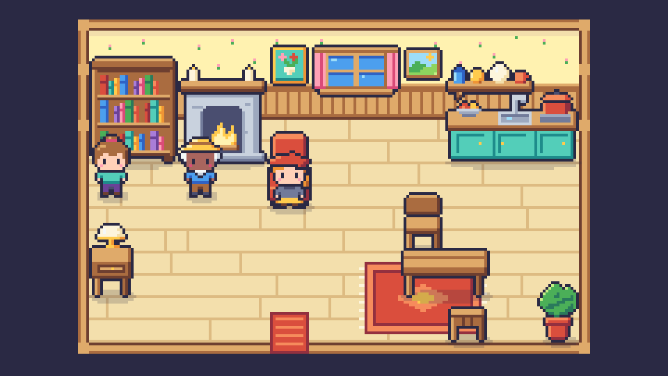

# Art direction: Willow Square in daylight

Simutown is a small, friendly town at midday.
The meadow is a light, fresh green, the paving is pale sand, the roofs are warm, and everything has a dark, confident outline.
People are two heads tall.
It should feel like a toy town: bright, chunky, and readable from the back of a classroom.

Every artist, human or agent, draws against this page so that the town reads as one hand.
The pictures in `docs/style/` show these rules applied.
Where a picture and a written rule disagree, the rule wins and the picture has a bug: say so in your report.

| File | What it shows |
|------|---------------|
| `docs/style/stylekey.png` | A corner of Willow Square, at x4. Every reference sprite in context. |
| `docs/style/characters.png` | The idle and walk frames of the whole cast, five people to a row, each labelled with its id. In each block, rows: down, left, right, up; columns: 2 idle frames on paving, 4 walk frames on grass. |
| `docs/style/pieces.png` | The approved repeat pieces at x8: window, door, roof corners, turf edge, shores, the tree, a person standing and stepping. Copy these pixels, not this prose. |
| `docs/style/palette.png` | The palette, one row per ramp, dark to light. Each swatch carries its slot name and, in red, its letter in a sprite grid. |

Regenerate them with `pnpm tsx tools/stylekey.ts`.
Review single sprites with `pnpm sheet <group>`.

Willow Square is its own place.
We take the qualities of the classic handheld RPG town - brightness, chunkiness, big heads, clarity - and none of its content.
Never copy a character, creature, tile or sprite from an existing game, and never name one in this repository.
Avoid outfits that add up to a famous character, even by accident: change a colour or a prop until the likeness is gone.
The people here are ordinary townsfolk.

### What the style key is, and what it is not

The style key fixes the rules: palette, outline, light, proportions, level of detail.
It is a sample of the town, and the town must not be forty copies of it.

- Copy the pieces that are meant to repeat: the window, the door, the roof face, the kit body, the turf edge, the shore.
- Do not clone the cottage with a new roof colour for every building. Vary width, storeys, roof shape, wall, door and where the windows sit.
- Do not reuse the three reference people as templates for faces and hair. Start each person from a new silhouette.
- The tree is one tree. Other trees get their own lobes: three or five, taller or wider, a pine, a fruit tree.
- Do not copy the layout. A square, a pond and a road meet differently in every town.

## The palette

Art uses the 38 slots of the `daylight` theme in `src/core/palette.ts` and nothing else.
Ramps run dark to light, and each one is hue-shifted: the dark end leans cool, the light end leans warm.
The second column is the slot's letter in a sprite grid (`LEGEND` in `src/core/sprite.ts`).

| Ramp | Grid | Use |
|------|------|-----|
| `steel.0` | `0` | Ink. Outlines and eyes, nothing else. |
| `steel.1-5` | `1 2 3 4 5` | Iron, slate, stone, and white. `steel.1` is also black hair. `steel.5` is the only pure white: glints, foam, daisies, cloth, white hair. |
| `cream.0-2` | `a b c` | The light ground of the town. `cream.1` is paving, `cream.0` its joints and bare earth, `cream.2` a warm near-white for plaster walls and paper. |
| `ochre.0-3` | `o p q r` | Orange to sunshine yellow: orange roofs, straw, blond and ginger hair, flower hearts, pale yellow plaster. Also lamplight. |
| `brick.0-2` | `x y z` | Warm red: tiled roofs, doors, poppies, a red shirt. |
| `moss.0-3` | `g h i j` | Green. `moss.2` is the grass, `moss.1` is leaves and tufts, `moss.0` leaf shade, `moss.3` sunlit tips. |
| `wood.0-2` | `u v w` | Trunks, beams, doors and window frames, benches, brown hair. |
| `skin.a/b/c.0-1` | `k l`, `m n`, `s t` | Three skin tones, each a shade and a base. |
| `plum.0-1`, `teal.0-1` | `d e`, `6 7` | Clothing, shutters, awnings. |
| `sky.0-2` | `8 9 f` | Water, window glass by day, blue roofs, denim. |
| `rose.0-1` | `+ *` | Flowers, cheeks, ribbons, a pink skirt. |

### Colour rules

- **Two colours own the ground.** `moss.2` (grass) and `cream.1` (paving) cover most of every frame, and they are reserved for it.
  A standing prop never uses either as its main colour: trees are `moss.1` with `moss.2` only as a highlight, walls are `cream.2` or `ochre.3`.
  That is why props and people pop off the ground without effort.
- **Ink is for lines.** `steel.0` draws outlines and eyes.
  It never fills an area larger than a few pixels.
- **Saturated colour goes on things that matter.** Roofs, doors, clothes and flowers get the strong reds, yellows, blues and pinks.
  Large surfaces (ground, walls, stone) stay light and quiet.
- **Three tones per material, where the ramp has them.** Shade, base, light, from one ramp.
  Two-slot ramps (`skin`, `plum`, `teal`, `rose`) are shade and base only: do not borrow a third tone from another ramp.
  A whole sprite rarely needs more than four ramps plus ink.
- **White is rare.** `steel.5` is the one pure white, for highlights of a few pixels, clothing and white hair; it is never a wall.
  `cream.2` and `ochre.3` are the two warm near-whites, and they are the wall colours. `ochre.3` is also the core of a lit window.
- **No hex colours in art, ever.** If a colour is missing, say so in your report; do not invent one.

## View and scale

- Top-down three-quarter view: we see the front faces of things and the tops of roofs. No perspective, no vanishing points.
- Tiles are 16x16. The frame is 480x270, so 30 tiles across. Everything is shown at x4 on a projector.

| Thing | Size in pixels | Notes |
|-------|----------------|-------|
| Person | 16x24 box, anchor [8, 24] | The figure itself is about 22 tall. Head 12 tall and 12 to 14 wide; body 10 tall, 12 wide at the arms. |
| Door | 16 wide, 24 tall | One tile wide, a tile and a half tall, frame included. A person must fit it. |
| Window | 15 wide, 13 tall | Four panes of 5x4 and a sill. A ground-floor window has its top level with the top of the door. |
| Ground storey | 32 tall | Two tiles, including a 4-pixel stone plinth. |
| Upper storey | 26 tall | At most one. Nothing in town is taller than two storeys and a roof. |
| Roof | 36 to 44 tall | See the roof rules below. |
| Cottage | 80x81 | Five tiles wide, one storey, footprint 5x3, door place one tile below the door. |
| Townhouse | 64x101 | Four tiles wide, two storeys, footprint 4x3. |
| Tree | 32x36 | A lobed canopy two tiles wide on a short, 6-pixel trunk. About one and a half people tall. |
| Lamp post | 16x32 | A 2-pixel post with a fat lantern. |
| Bench | 32x20 | Two tiles wide; the seat's top plane is 4 pixels deep. |
| Flower | 3x3 | A plus of petals around a heart. About eight to a patch, all one colour. |
| Paving stone | 8x8 | Rounded corners, running bond. |

Chunky beats detailed.
If a shape is thinner than 2 pixels (plus its outline), make it fatter or leave it out.

### Small props show their top

In this view we look down a little on everything.
Any prop with a flat surface below eye level shows that surface: a bench its seat, a crate its lid, a barrel its top, a table its board, a well or a planter its rim and what is inside.

- The top plane takes the material's light tone and is a third to a half as deep as the front face is tall.
- Where one part stands behind another (a bench's backrest behind its seat), give the rear part an underside row in the material's dark tone before the ink line, so the two do not fuse.
- The front face takes the base tone. Side faces are not drawn; a 1 or 2-pixel column of shade on the right end is enough.
- Things at or above eye level (a lamp's lantern, a sign, a roof ridge) are drawn from the front, with no top plane.
- A prop seen only from the front, as a flat cut-out, is wrong.

## Line and shading

- **Outlines.** People and standing props have a closed 1-pixel ink outline around the silhouette, base line included.
  Closed means closed: no coloured pixel touches an empty pixel or the edge of the sprite's box, so leave a row or column free for the ink.
  Round the corners by dropping the corner pixel; nothing in this town has a sharp square corner except a wall.
- **Ink inside a sprite** separates major parts that overlap: head over body, hat brim over face, roof over wall, seat over backrest.
- **Detail inside one part** uses that part's own dark shade: `wood.0` around a window, `brick.0` under a course of roof tiles, the shirt's shade under an arm.
- **Terrain and flat props have no ink at all.** Their darkest line is the dark end of their own ramp.
- **Light comes from the upper left.** Top and left faces take the light tone, right and bottom faces the shade.
  Highlights are small (a lip, a glint, a 1-pixel rim on a leaf lobe); shade may be broader on the lower right.
- **Flat colour.** No gradients, no dithering, no anti-aliasing, no pillow shading.
- **No cast shadows in sprites.** The renderer draws them: a flat ink ellipse at about 22% under every person and standing prop, and a 2-pixel strip along the base of a building. The style key shows the midday version.
- **Calm ground.** A grass tile carries nought, one or two small marks (a `moss.1` tuft, a `moss.3` blade), a little over one on average, never a speckle. Large areas must stay quiet so that people stand out.
- **No visible grid.** A material that covers many tiles needs at least three variants whose marks sit on different rows and columns. Check the mixed view of `pnpm sheet terrain`: no seams, no repeat that draws the eye.
- **No faces by accident.** Two marks side by side on a round shape read as eyes. Leave round shapes plain.

## Ground

- `grass` has eight variants, each with nought, one or two marks, and no two marks across the variants share a row and a column; the renderer mixes them by tile position.
  `meadow` is the same lawn with about one wild flower a tile, and meets grass without an edge.
- `cobble` is the town's pale paving, for squares and streets. A tile opens with a full course of stones, so a road never starts on a half-cut row. About one glint per tile.
- `dirt` is a trodden footpath: flat `cream.0` with at most three marks per tile (a `wood.2` scuff, a `cream.1` pebble). It may be one tile wide, and it should wander: turn it every two or three tiles.
- A door that opens onto a lawn gets the `stepping-stones` flat prop, one tile per step. Never pave a one-tile spur to a door.
- Edges are fringes: thin pieces that a higher-priority terrain draws on its neighbours. There are twelve grounds (`src/art/terrain/index.ts`), from low to high priority:

  | Priority | Ground | Its edge |
  |---|---|---|
  | 0 | `dirt` | none of its own |
  | 1 | `cobble` | none of its own |
  | 2 | `road`, grey flagstones | a kerb line on cobble and dirt |
  | 3 | `soil`, a garden bed | a crumbling dark border on road, cobble and dirt |
  | 4 | `grass`, `meadow` | the turf edge on everything below; none between the two |
  | 5 | `tall-grass` | the turf edge one tone deeper |
  | 6 | `water`, `basin` | the pond's bank, the basin's stone rim |
  | 7 | `sand` | shallow tongues closed by a line of wet sand, over land and into water |
  | 8 | `plank`, `plank-v` | a straight wooden edge with a 2-pixel front face, over anything |
- **The turf edge.** Grass creeps over paving and dirt in lumps 1, 2 and 3 pixels deep, in runs of uneven length. Never a regular wave: it reads as battlements.
  Each side has three interchangeable strips, which the renderer picks per tile, so a long edge does not repeat every 16 pixels. Every strip starts and ends 2 pixels deep, so any strip joins any other.
  One line of darker green closes the edge: `moss.1` where it faces the light (north and west), `moss.0` where it faces away. Inner corners (`in-ne` and friends) add a wedge of grass that rounds the bend.

### Which grounds may touch

A fringe exists only where the table says yes; any other pair meets in a hard, ugly seam.
"Grass kinds" means `grass`, `meadow` and `tall-grass`.

| Ground | May touch |
|---|---|
| `grass`, `meadow` | everything; they meet each other without an edge |
| `tall-grass` | `grass`, `meadow`, `dirt`, `cobble`, `road`, `soil`, `water`, `sand`, `plank` |
| `dirt` | grass kinds, `soil`, `sand`, `plank`; `cobble` and `road` end-on only |
| `cobble` | grass kinds, `road` (the kerb), `soil`, `basin` (the stone rim), `sand`, `plank` |
| `road` | grass kinds, `cobble`, `soil`, `basin`, `sand`, `plank` |
| `soil` | grass kinds, `dirt`, `cobble`, `road`, `plank` |
| `water` | grass kinds (the bank), `sand` (a beach), `plank` |
| `basin` | `cobble`, `road`, `grass`, `meadow` |
| `sand` | grass kinds, `water`, `dirt`, `cobble`, `road`, `plank` |
| `plank`, `plank-v` | everything but `basin` |

- "End-on only": a dirt path may run into paving across the width of the path. Dirt and paving never run side by side.
- Where the table says no, put at least one tile of grass between the two.
- **A deck starts one tile inland.** A boardwalk or bridge of `plank` that reaches over water starts one tile inland on each bank, so the bank runs under it.
- New terrain must say which row of this table it joins, and bring the fringe for it.

## Water

- Water is flat `sky.1`. Each of the four variants carries one or two `sky.2` ripples of different lengths (2 to 5 pixels), on rows and columns no other variant uses. More than two per tile reads as confetti. One variant may have a single `steel.5` sparkle.
- Water shimmers slowly: each variant is a 4-frame animation in `anims`, at 2 frames a second, in which the ripples slide 2 pixels to the right and back. Ripples keep 2 pixels clear of the tile's sides so the slide never splits one. Nothing else in the water moves.
- **Shores curve.** The water spills 8 pixels into its neighbours, outer corners are quarter discs, and the `in-*` pieces round the tip of land where the shore turns inwards. Lay a pond as a blob: step its outline one tile at a time, keep it at least two tiles across everywhere, and avoid a straight shore longer than four tiles.
- **`water` is a natural pond**, for meadows and parks: grass, a 1-pixel `moss.0` lip, then the water. Along the north and west banks the land throws a 2-pixel `sky.0` shadow on the water; along the south and east banks there is a 1-pixel `sky.2` line of foam instead.
- **`basin` is the same water in a rim of pale stone**, for squares and gardens: a `steel.2` outer line, a 3-pixel `steel.4` top with `steel.3` joints, shadow and foam as above. A basin is a rectangle with rounded corners, set in paving (`cobble`, `road`) or in a lawn (`grass`, `meadow`), and nowhere else.
- Lily pads and reeds are flat props placed on water tiles, away from the shore pieces.

## People

People are made with `makeCharacter` (`src/art/characters/make.ts`), from named choices: a body shape, a skin tone, a hair style and colour, a hat, a top, a bottom, shoes, one accent and a few accessories.
It assembles a shared body, drawn once per shape in role letters, with three head grids (facing down, up and right; left is right mirrored), and returns every frame: a 2-frame idle, a 4-frame walk, and the poses `sit`, `wave`, `talk` and `carry`.
A wrong choice throws an error that lists the valid ones, and `CHARACTER_OPTIONS` lists them all.
Draw a new head or hat in `heads.ts`, or a new body in `bodies.ts`, only when the choices cannot make the person; everyone else is a few lines of spec.

- **Four builds.** `adult` is the standard body. `broad` is the same height and two pixels wider across the shoulders (two columns repeated). `child` is three rows shorter under the same big head, does not sink in a step (the head bobs and one foot lifts) and walks at 10 frames a second. `elder` is the adult body with the head carried one pixel lower and, from the side, one pixel further forward; give an elder a cane, and the hand that holds it stops swinging.
- **Two heads tall.** The head, hair included, is 12 rows; the body is 10. Do not grow the body to add detail.
  In the kit, a head grid is 14 rows: 2 spare rows on top for a bun or a hat, then the 12 rows of the head, the last of which is the chin's ink line. A body grid is 11 rows: 1 row that the chin covers, then the 10 rows of the body. Together they fill the 24-row box, overlapping by that one row.
- **Faces.** Two ink eyes, each 1 pixel wide and 2 tall, on rows 9 and 10 of the box, at columns 5 and 10 when facing the viewer.
  No nose, no mouth.
- **Cheeks.** One pixel per cheek, on the row under the eyes: `rose.1` on `skin.a` and `skin.b`, `rose.0` on `skin.c`. Every skin tone gets them or none does.
- **Hair** has a base, and where the ramp allows a shade and a light:

  | Hair | Shade | Base | Light |
  |------|-------|------|-------|
  | Brown | `wood.0` | `wood.1` | `wood.2` |
  | Black | none | `steel.1` | `steel.2` |
  | White or grey | `steel.4` | `steel.5` | none |
  | Blond | `ochre.1` | `ochre.2` | `ochre.3` |
  | Ginger | `ochre.0` | `ochre.1` | `ochre.2` |

  Black hair has a base and a light only: never map a hair role to `steel.0`, because ink is not a fill.
  The light is a short sheen on the upper-left of the crown. Keep the back of a head plain: a streak and a dot there read as a face.
- **Silhouette first.** Each person must be recognisable as a black shape: a bun, a straw hat, long hair, a chin tuft, a skirt.
  Hair may use the two rows above the head and may hang over the shoulders.
- **Hats go over the hair.** A hat is an overlay on a hair style: it erases what it covers (a bun under a cap), and hair that hangs below it (long hair, plaits, white hair over the ears) still shows. The kit has a straw hat, a peaked cap, a beret, a headscarf and a tall chef's hat. A headscarf wraps under the chin and shows a strip of hair at the brow, or of skin on a bald head. A hat band or badge takes the accent colour.
- **Colour second.** One strong colour for the top, a different one for the legs, and at most one small accent (a ribbon, a hat band). Avoid `moss.2` and `cream.1` in clothes: they are the ground.
- **Bodies are plain.** No buttons, belts or pockets. A sleeve is separated from the chest by one pixel of the top's shade.
- **Facial hair stays small.** A beard is a chin tuft that hangs below the chin, never a patch on the face: facing the viewer, 4 pixels of hair on the chin's line, then 2 pixels of the hair's shade under them, closed in ink, with a full row of skin between the tuft and the cheeks. From the side it is 2 pixels at the point of the chin. A wider or higher patch of white reads as a grin or a mask.
- **Idle** is two frames: the head settles by 1 pixel on the second.
- **Walk** is four frames: step, stand, other step, stand.
  A step must change the silhouette, or it reads as jitter on a projector.
  Facing the viewer or away: the head and body drop 1 pixel, the landing foot is 3 pixels wide and low, the other leg stays in its own column and ends one row higher, and the arms swing against the legs (one hand 2 pixels up, the other 1 pixel down).
  Facing sideways, the two strides alternate which leg leads. On the first, the far leg reaches ahead with its foot lifted 1 pixel off the ground, the near foot stays planted behind, and the hand swings out in front of the body. On the second, the near leg leads and is planted, the far foot lifts behind, and the hand swings out behind.
  Facing the viewer, the second step is the first mirrored.
- All three skin tones are in the reference cast; keep it that way as the cast grows.

## Buildings

A building is a roof, a wall and a plinth, assembled from small pieces (see `src/art/buildings/index.ts`).

### Roofs

- Every roof shows its long slope to the viewer, with the ridge running left to right. We do not draw a triangular gable facing the viewer: tile courses stay horizontal across the whole town.
- **The face.** Courses are 5 pixels tall. Tiles are 6 to 9 pixels wide so that no two courses line up. Some tiles hang with a rounded bottom and some with a straight one, so the shade lines under the courses never settle into a regular wave. About one tile in three has a lit lip, and a lip spans its own tile, from joint to joint. No full grid of joints: a roof must read as tiles, never as a brick wall or as stripes.
- **Blue roofs stay calm.** On a `sky` roof keep the lit lips on one course in three, or the roof sparkles like the pond.
- **Wide roofs.** The roof face is 80 pixels wide. On a wider building, continue it from its left edge again but two courses (10 pixels) further down, so the join never lines up, and stand a chimney or a dormer on the join. No building is wider than ten tiles.
- **The ridge** is a cap of the ramp's light tone, 3 pixels tall, with a joint every 7 pixels and a shade line under it.
- **The eave** is the bottom 5 rows: a lit lip, two rows of base, a shade line, ink. It covers the top 2 pixels of the wall.
- **Overhang.** The roof is 3 pixels wider than the wall on each side.
- **Gable roof** (the cottage): straight sides, finished with 2-pixel bargeboards, `cream.2` on the lit left and `cream.0` on the shaded right. 40 to 44 tall on a one-storey house, about 1.4 times the wall.
- **Hip roof** (the townhouse): each side leans in 8 pixels between the eave and the ridge, in steps of 1 pixel every 4 rows. No bargeboards: a 2-pixel band of the roof's light tone runs up the left edge and of its shade up the right. 36 to 40 tall.
- **Two storeys.** The roof does not grow with the building: keep it 36 to 40 tall, about two thirds of the wall. Prefer a hip roof on tall buildings; it keeps them from looming.
- **Narrow buildings** (three tiles or less) take a roof of 32 to 36.
- **Colour.** Red (`brick`) is the default; orange (`ochre`) and blue (`sky`) are the alternatives. Recolour the whole roof ramp for ramp; do not mix.
- A chimney stands on the slope, right of centre, and clears the ridge by 6 pixels.

### Walls

- Walls are `cream.2` plaster, or `ochre.3` for a pale yellow house, with a `cream.1` shadow 4 pixels deep under the eave and a `steel` plinth.
- A cottage has a `wood` timber frame: a beam under the eave and posts at the corners and beside the door, each 4 pixels wide.
- Three more materials show a few joints, never a full grid, on the light tone of their ramp:
  - **brick**: `brick.2` in a running bond of 4-pixel courses, with only a few bricks drawn, far apart, in `brick.1`; the eave's shadow is `brick.1`.
  - **stone**: pale dressed blocks about 10 by 6 in `steel.4`, part of the joints drawn in `steel.3`; the eave's shadow is `steel.3`.
  - **planks**: upright `wood.2` boards 6 pixels wide, a `wood.1` line between them; the eave's shadow is `wood.1`.
- A house of two storeys marks them with a 2-pixel string course in its material's light and shade (a second beam on a timber frame), and may hang `teal` or `plum` shutters beside the upstairs windows.
- **Doors** are painted a strong colour or left in varnished wood, with inset panels (shade on the top and left of a panel, light on the bottom and right) and a brass knob in `ochre.2`.
- **A door stands on a whole tile**, so that a person walking in lines up with it: a single door is centred on the middle of a tile, a double door covers two whole tiles. A door needs a tile clear of each corner, so the narrowest building is three tiles. The walkable tile in front of the door is the building's `door` place.
- **The footprint is the ground the building really covers**, which is less than its picture: the wall is pure height, and the roof is partly height and partly depth. It is as wide as the sprite, so nobody walks through a wall or squeezes past a corner, and one to three tiles deep, counted up from the base line: as deep as it can be while the ridge still hides a person standing on the first free row behind it (at most 2 pixels of hair show). Two storeys, or one storey under a 44-pixel roof, give 3 tiles; a lower roof on one storey gives 2. So a person who walks behind a building disappears behind the roof line and comes back into view at either end, and nobody ever stands on a roof.
- **Windows** by day are `sky.1` glass with a `sky.0` shadow along the top of each pane and a small `sky.2` glint, in a `wood.0` frame.
  A window box of flowers is welcome on the ground floor.

### Shops, the school, the hall

A teaching town needs a few buildings that are not houses.
They are built from the same pieces and the same rules; each gets one feature that names it, and no other ornament.

- **Shop.** A house with a wide shop window (two windows side by side, sharing a sill) and a striped awning over window and door: stripes 4 pixels wide, `steel.5` and one strong colour, 8 to 10 pixels tall, with a shaded lower edge. A hanging sign, about 12x10 on an iron bracket, shows an icon of two or three colours (a loaf, a book, a boot). Signs never carry lettering: it cannot be read at this size.
- **School.** One storey, seven or eight tiles wide, under a gable roof. Tall windows (the usual window with a third row of panes), a double door in the middle (two doors side by side, 32 wide), and a small bell turret on the ridge.
- **Hall.** The one landmark of a town, and the only building that may rise above two storeys: two storeys and a hip roof, plus a clock turret in the middle, to at most nine tiles (144 pixels) in all. One per town. It sits on the square.
- Everything else (a cafe, a clinic, a library) is a house or a townhouse with a sign and at most one extra: an awning, a bench, a planter.

## Nature

- **Trees are built from lobes.** Three to five overlapping leaf lobes over a darker mass, never a single ball and never mirror-symmetric.
  Lay the lobes off-grid: one larger crown lobe left of centre, a smaller lobe tucked under it on the right, lower lobes of different widths. Never four lobes in a 2x2 block.
  Each lobe is flat `moss.1`, with its own `moss.0` underside where it overhangs the lobe below. The undersides meet in T-junctions; they never cross in a "+", which reads as a quartered ball.
- **The lit rim is thin.** `moss.2` is the grass colour, so a wide band of it inside the outline reads as lawn and the canopy dissolves. The sunlit rim is 1 pixel inside the ink along the upper-left silhouette, never more than 2, with a few `moss.3` pixels at the top-left tips.
- **The outline is always closed**, all the way round the canopy and the trunk.
- No dots, ovals or dashes inside a lobe.
  The fruit tree's apples are the one exception: 2x2 fruit in `brick`, spread over the lobes so that no two sit close together side by side, where they would read as eyes.
- A hedge or a bush follows the same recipe.
- Trunks are short and fat: `wood.2`, `wood.1`, `wood.0` in three vertical bands from left to right, darker where the canopy shades them.
- **Flowers come in clusters of one colour**: poppies (`brick.1`), daisies (`steel.5`), buttercups (`ochre.2`), pinks (`rose.1`), cornflowers (`sky.1`) and violets (`plum.1`), each with a contrasting heart and a few `moss.1` leaves. There are two drawings, a tight cluster and a looser one set lower in the tile, so that two patches side by side are not twins; a new colour is a recolour of one of them.
- Flowers, lily pads and stepping stones are flat props: no ink, no footprint, drawn under people.
- A flat prop made of stone or wood sits on a base of its own dark tone along its lower edge (stepping stones: `cream.1` on `cream.0`), or it floats over the lawn.

## Fences and other long things

- A fence is waist-high on a person: 10 to 12 pixels, never taller than a body.
- Posts are 4 pixels wide with their outline and rounded on top; two rails, each 2 pixels tall, `wood.2` with a `wood.1` underside. No 1-pixel rails or pickets.
- Rails leave both sides of the tile on the same rows, so segments join without a seam. A run ends on a post.
- **Assembling a fence.** An east-west run is `fence-h-left`, any number of `fence-h`, then `fence-h-right`, so it starts and ends on a post. A north-south run is `fence-v` pieces under a `fence-v-top`, or under any horizontal piece where two runs meet at a corner.
- A hedge follows the tree recipe: flat `moss.1`, a 1-pixel lit rim along the top-left, a `moss.0` underside, a closed ink outline. It is clipped and chest-high: 12 pixels thick, rising 10, so we see 8 rows of its top, a scalloped `moss.0` line where the top overhangs, then the front face down to a shaded foot.
- **Assembling a hedge.** An east-west row is `hedge-h-l`, any number of `hedge-h`, then `hedge-h-r`. A north-south row is `hedge` at the north end, then `hedge-v` for every tile below it; each piece covers the front face of the one above. A corner at the north end of a north-south row is `hedge-h-l` or `hedge-h-r` with `hedge-v` below it; a corner at the south end is `hedge-sw` (the row turns east) or `hedge-se` (it turns west). `hedge` alone is a clipped block.
- Anything that repeats along a street (fence, hedge, wall, kerb) needs an end piece and must look right three tiles long and ten tiles long.

## Interiors

A scene can follow people indoors, into a room behind a door.
A room is as bright as the square outside: light floors, light walls, warm wood, the cosy inside of a handheld-RPG house.
A dark, moody room is wrong.

### The room view

- The same top-down three-quarter view as outside: we see the front faces of things and the tops of the low ones.
- **The back wall** is a face two tiles (32 pixels) tall along the top of the room: an upper row and a base row.
  The upper row starts with a 2-pixel band of the wall's own shade under the cap; the base row ends in a skirting (5 rows of `wood`, dark on the last) or a wainscot (a dado rail, then upright boards), so the wall meets the floor on a clean dark line.
- **The floor** lies below the wall. There is no ceiling.
- **The sides and the front** are not drawn as faces. The top of the walls is a wooden cap 4 pixels wide: dark on the room side, light, light, mid on the ink side. It runs above the back wall, down both sides and along the open front.
- **The cap lies outside the room**, on the ink: every floor and wall draws it as its fringe on the ink tiles around it. So furniture against a side wall or the front can never paint over it, and a room needs no corner pieces.
- **The exit** is a doormat on the bottom floor row. It reaches 4 pixels further down, over the front cap, so the room's edge opens where the door is.
- **Everything outside the room is ink** (`steel.0`). Ink is the one ground allowed to be ink.

### Sizes

The camera frames a room at zoom 2, which shows 15 x 8.4 tiles (240 x 135 pixels).
A room, walls included and its ink border not counted, is **at most 14 x 7 tiles**: two rows of wall and up to five of floor.
The cap lies outside the room, 4 pixels on every side, so the box is 14 x 16 + 8 = 232 pixels wide and 7 x 16 + 8 = 120 tall at most, and the frame shows all of it with a margin of ink on all four sides: the room reads as a closed box, never as a cropped picture.
A small home can be smaller.
Furniture stands next to 16 x 24 people and must read at that size.

| Thing | Size in pixels | Notes |
|-------|----------------|-------|
| Room | at most 14 x 7 tiles | Walls included, ink not counted. |
| Back wall | 2 tiles tall | The cap sits on the ink above it. |
| Window | 16 x 32, or 32 x 32 with curtains | On the wall: the frame starts 6 rows under the cap and the sill sits about 10 pixels above the skirting. |
| Table | 32 x 18 | A 6-row top whose back edge is 17 pixels above the base line; see Seats. |
| Chair | 16 x 22, from behind 16 x 13 | The back is a solid panel, never thin spindles; from behind it shows a lit top rail and two slats. |
| Bed | 16 x 40, double 32 x 40 | Head to the wall, two tiles deep. |
| Tall cupboards | 32 x 39 | Wardrobe, bookshelf, bread rack: above eye level, so no top plane. |
| Counter | 48 x 29 | Three tiles; goods stand on its top. |
| Desk | 16 x 24, teacher's 32 x 28 | A closed front 10 rows tall, so it hides the feet of whoever stands behind it. |

### Floors

Boards, never bricks.

- **Boards** run left to right, 7 pixels wide, two to a tile, with a joint line one tone darker than the board under each (`floor-pine`: `cream.1` boards, `cream.0` joints; `floor-wood`: `cream.0` boards, `wood.2` joints). `wood.2` is the darkest tone that covers any length of a floor.
- A board is 32 to 64 pixels long: most rows cross a whole tile with no end joint, and a tile has at most one end joint in each board. End joints sit on different columns in every variant, so they never line up into a running bond.
- **Flagstones** (`floor-stone`) are a whole tile tall, each tile cut once at its own column, with the same structure in every variant. About two tiles in five carry a glint, and a glint hugs the top-left corner of a slab; no free-floating dashes.
- **Checks** (`floor-checker`) are 8 pixels, in two near creams, so they stay quiet under people.
- Every floor has at least three variants (a checker excepted), and the mixed view of `pnpm sheet interior` shows no grid.

### Walls

- Wall faces are light and quiet: `cream.2` plaster, `ochre.3` paper, `sky.2` and `cream.2` stripes, `wood.2` panelling, or `brick.2`.
- Paper carries rose sprigs, two to a tile on a loose diagonal, at a different offset in each variant: a pattern, never a grid of dots and never a few stray specks.
- Brick follows the outdoor brick rule: a few bricks drawn far apart, never a course line across the wall, and no shade band under the cap. A whole wall of brick is the loudest surface in a room, so prefer brick on the base row under plaster.
- Any upper row goes with any base row: plaster over a brick base, paper over a wainscot.
- **What goes on walls**: windows, pictures, a clock, a shelf, a menu board or a blackboard, a wall lamp, a banner, an inner door. They hang on the back wall only, have no footprint and cast no shadow, and keep within the 32 pixels of the wall.
- Boards (signs, menus, blackboards) carry chalk shapes and lines, never lettering or digits.

### Furniture

- Every rule of props holds: a closed ink outline, light from the upper left, three tones a material, and a top plane on anything below eye level.
- Furniture stands out from the floor by its outline and by a different tone or material: on both floors the furniture's wood is at least one tone darker than the boards.
- Pieces against a wall stand on the first floor row (or column) and rise over the wall face; the cap stays clear of them because it lies on the ink.
- Small goods on a counter or a shelf (bread, cups, jars, books) are 3 to 11 pixels across, in strong colours, and stand on the top plane. Keep them off the middle of a counter's top, where the feet of whoever stands behind it would show.
- **Feet behind low pieces.** Someone standing on the tile right behind a piece has their feet 20 pixels above its base line. A piece people stand behind (a counter, a desk, a lectern) is at least 22 pixels tall, so it hides their feet. A table is lower, 18 pixels, for the sake of its sitters: stand people beside a table or two rows behind it, and put chairs on the tile behind it.
- **Seats.** A sitter facing the viewer sits on the chair's base line (props are drawn before people on the same line), so they are drawn over the seat with the chair's back showing around their head. At a table, the chair stands on the tile behind it, 16 pixels up: the tabletop's back edge comes 17 pixels above the table's base line, about 8 rows under the sitter's chin, so their shoulders, arms and shirt show and the table hides their lap. A chair seen from behind is drawn over its sitter (seat 5 pixels behind its base line) and hides their body, never their head. A bar stool works the same way: its sitter faces the bar and sits 14 pixels behind its base line, so the stool's cushion shows just under them and its legs below.

### Light in a room

- By day, no lamp is lit and window glass is `sky`, as outside.
- After dusk, window glass turns to night glass (`steel.1`, `sky.0`, `sky.1`) in the emissive layer, and a window has no light of its own.
- Lamps, the fireplace and the oven keep an emissive layer and a light, so the room is lit from inside: lamp glass and shades in `ochre.2` and `ochre.3`, embers in `ochre.1`.

## Daylight, dusk and night

Bright daylight is the default, and all art is drawn for it.
The renderer will also offer dusk and night moods by darkening and tinting the frame, and then switching the lights on.

- Any prop that can glow keeps an `emissive` sprite of the same size and anchor, plus `lights`.
- The day sprite shows the thing unlit: window glass in `sky`, lamp glass in `cream`.
- The emissive sprite repaints only the glass: `ochre.2` with an `ochre.3` core. Window bars and frames stay out of it, so they read dark against the glow.
  Two things besides glass may glow: drawn-back curtains, a pelmet along the top of the glass and a drape 2 pixels wide down each side in `ochre.1`, as cloth lit from behind (`lit: 'curtains'` in `makeBuilding`); and a clock face, whose dial turns `ochre.3` while its hands stay dark.
  Mix `warm`, `curtains` and `dark` windows along a street: with all three, it feels inhabited.
- `pnpm sheet` shows both versions side by side. Check that the lit one feels warm and inhabited.

## Do and do not

Do:

- Start from the silhouette, fill it with one flat colour, then add one shade and one light.
- Reuse the reference pieces: the window, the door, the roof face, the kit body, the shores. `docs/style/pieces.png` shows them at x8.
- Look at your sprite in the style key's company, at x4, from across the room.
- Lay walk frames side by side and check that they read as walking.

Do not:

- Use ink as a fill (not even as a hair shade), or leave an outline open.
- Put a band of `moss.2` wider than 2 pixels inside a tree or a hedge.
- Use `moss.2` or `cream.1` as the main colour of a standing prop or of clothing.
- Dither, anti-alias, or shade with more than three tones of one ramp.
- Speckle the ground, repeat one tile across a field, or draw an edge as a regular wave.
- Paint a cast shadow into a sprite.
- Draw thin things: a 1-pixel fence rail, a 1-pixel limb.
- Draw a prop as a flat front view when its top would be visible.
- Give a person a small head, a mouth, or realistic proportions.
- Light anything from the right.

## Checklist before you call a sprite done

1. Rendered and looked at, at x4, next to the style key.
2. Correct size and anchor (the contract test checks this).
3. Bright: each material's base is the middle or light tone of its ramp; the dark tone is only shade. Iron is the one exception.
4. Chunky: no part thinner than 2 pixels, corners rounded.
5. Closed ink outline on people and standing props, with no coloured pixel on the edge of the box; no ink on terrain and flat props.
6. Light from the upper left, at most three tones per material.
7. It does not use the ground colours as its own.
8. Its top plane shows, if it has one below eye level.
9. Nothing in it repeats on a visible grid.
10. Anything that glows has an emissive layer.
11. It still reads when you squint.
