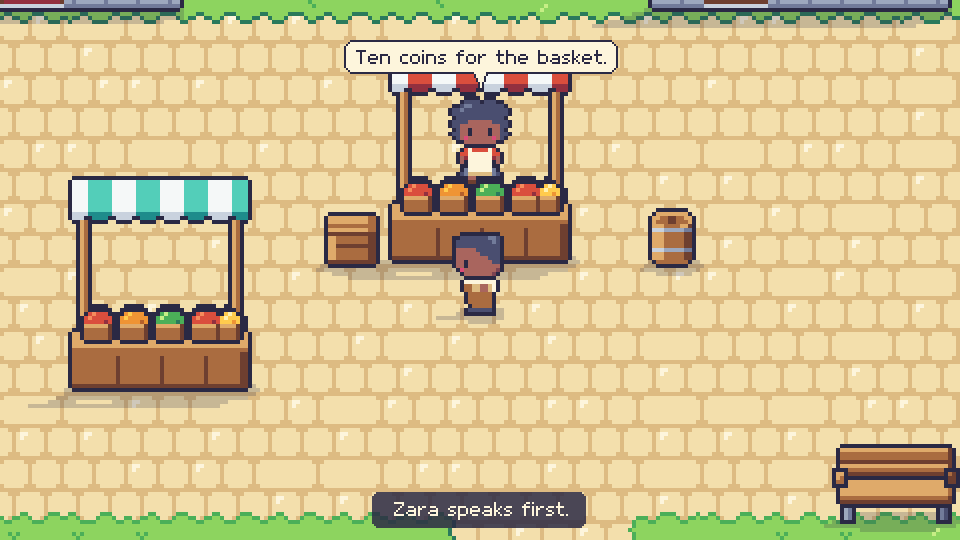
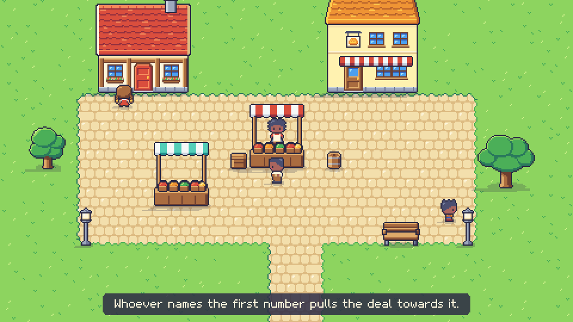

# Writing a scene

This guide takes you from "I want to show X" to a rendered film.
It is written for people and for coding agents alike, and every command and sample in it has been run.
The full list of calls is in the [scripting API reference](scene-api.md); this page shows how to use them well.

The loop is short:

1. Plan the beats: what the viewer should understand, one idea at a time.
2. Pick a town, or build a small one, and list its places with `describeTown`.
3. Cast the townsfolk.
4. Script the beats with the scene API.
5. Render stills at the important moments and look at them.
6. Render the film.

Steps 4 and 5 repeat until the stills look right.

## 1. Plan the beats

A scene explains one idea.
Write that idea down as a single sentence before you write any code, for example: "the first number named in a negotiation pulls the deal towards it."

Then break it into beats.
A beat is one thing the viewer sees and understands, usually 3 to 8 seconds long.
Most scenes need four to eight beats:

- a title card that asks the question;
- a set-up: who is where, and what they want;
- the event, one line or one action at a time;
- the point, said plainly in a caption, with the picture still showing it;
- often a contrast: the same situation with one thing changed;
- the takeaway, then a fade.

Keep the cast small.
Two or three people carry the idea; anyone else is background, wandering, and should not compete for attention.

## 2. Pick or build the town

**Willow Square** is the built-in town (`src/towns/willow-square.ts`, exported as `willowSquare`), with a square, shops, houses, a pond and a park.
Use it when the story fits a town square, which is most of the time.

Whatever town you use, list its places before you script.
`describeTown` prints the map, the props and every place name, so you can plan without seeing the picture:

```bash
pnpm tsx -e "import { describeTown } from './src'; import { market } from './examples/market'; console.log(describeTown(market))"
```

For Willow Square, import `willowSquare` from `./src/towns/willow-square` instead.
Any scene file works too, because every scene carries its town: `import scene from './scenes/hello'` and print `describeTown(scene.town)`.

The market square of the worked example below prints this:

```text
Market Square: 30 x 17 tiles. x grows right, y grows down, [0, 0] is the top-left tile.

   0         1         2
   012345678901234567890123456789
 0 gggggggggggggggggggggggggggggg
 1 gggggggggggggggggggggggggggggg
 2 ggggg#####ggggggg#####gggggggg
 3 ggggg#####ggggggg#####gggggggg
 4 ggggg#####ggggggg#####gggggggg
 5 ggggccc9cccccccccc1ccccccggggg
 6 ggggcccccccccccccccccccccggggg
 7 ggggcccccccccc8ccccccccccggggg
 8 gg#gcccccccc####c#cccccccggggg
 9 ggggccccc5cccc7ccccccccccg#ggg
10 ggggcccc###ccccccccccc6ccggggg
11 ggggccccc4cccccccccccccccggggg
12 gggg#ccccccccccccccc##cc#ggggg
13 ggggggggggggggcccggg23gggggggg
14 ggggggggggggggcccggggggggggggg
15 ggggggggggggggcccggggggggggggg
16 ggggggggggggggcAcggggggggggggg

Legend:
  g grass
  c cobble
  # prop footprint (solid)

Props (origin = bottom-left tile of the footprint):
  house (house) at [5, 4], footprint 5x3 tiles
  bakery (bakery) at [17, 4], footprint 5x3 tiles
  fruit-stall (stall) at [13, 8], footprint 3x1 tiles
  ...

Places (walkable tiles you can use as targets):
  1 bakery.door [18, 5]
  2 bench.left [20, 13]
  3 bench.right [21, 13]
  4 cloth-stall.front [9, 11]
  5 cloth-stall.vendor [9, 9]
  6 corner [22, 10]
  7 fruit-stall.front [14, 9]
  8 fruit-stall.vendor [14, 7]
  9 house.door [7, 5]
  A south [15, 16]
```

Places are the names a script uses: `fruit-stall.front` is the tile in front of the stall, `fruit-stall.vendor` the tile behind it.
Props are not places: to walk to the bakery, walk to `bakery.door`.
A tile `[x, y]` works anywhere a place does, but a name reads better and survives changes to the map.

### Building a small town

When the story needs a setting Willow Square does not have, define one with `defineTown`.
This is the town of the worked example, a market square with two stalls:

```ts
// examples/market.ts - a small market square, used by the worked example in docs/authoring.md.
import { defineTown } from '../src';

export const market = defineTown({
  name: 'Market Square',
  terrain: `
    gggggggggggggggggggggggggggggg
    gggggggggggggggggggggggggggggg
    gggggggggggggggggggggggggggggg
    gggggggggggggggggggggggggggggg
    gggggggggggggggggggggggggggggg
    ggggcccccccccccccccccccccggggg
    ggggcccccccccccccccccccccggggg
    ggggcccccccccccccccccccccggggg
    ggggcccccccccccccccccccccggggg
    ggggcccccccccccccccccccccggggg
    ggggcccccccccccccccccccccggggg
    ggggcccccccccccccccccccccggggg
    ggggcccccccccccccccccccccggggg
    ggggggggggggggcccggggggggggggg
    ggggggggggggggcccggggggggggggg
    ggggggggggggggcccggggggggggggg
    ggggggggggggggcccggggggggggggg
  `,
  legend: { g: 'grass', c: 'cobble' },
  props: [
    { kind: 'house', at: [5, 4] },
    { kind: 'bakery', at: [17, 4] },
    { kind: 'stall', at: [13, 8], id: 'fruit-stall' },
    { kind: 'stall-teal', at: [8, 10], id: 'cloth-stall' },
    { kind: 'barrel', at: [17, 8] },
    { kind: 'crate', at: [12, 8] },
    { kind: 'lamp', at: [4, 12] },
    { kind: 'lamp', at: [24, 12] },
    { kind: 'tree', at: [2, 8] },
    { kind: 'oak', at: [26, 9] },
    { kind: 'bench', at: [20, 12] },
  ],
  places: { south: [15, 16], corner: [22, 10] },
});
```

Rules of thumb for a town:

- **30 by 17 tiles fills the frame** at zoom 1 (480 x 270 pixels, 16 pixels a tile). A smaller town is centred on ink; a larger one is fine, and the camera moves over it.
- **A prop's `at` is the bottom-left tile of its footprint**, and the footprint grows right and up. A building's door is on its bottom row, so leave the row below it walkable: that is where its `door` place is.
- **Name the spots your script will use** in `places`, and give props an `id` when the kind repeats or when the name says more (`fruit-stall`).
- **Which grounds may touch** is a table in [the art direction](STYLE.md#which-grounds-may-touch). Grass and cobble go with everything; put a tile of grass between any pair the table does not list.
- The prop kinds and terrain ids are listed in the error message if you get one wrong, and in the Atlas of the gallery (`pnpm dev`, then Atlas).

## 3. Cast from the townsfolk

Fourteen townspeople come with Simutown.
Cast by role and look; the id is what you pass to `s.actor()`.

| id | Name | Role | How they look |
|---|---|---|---|
| `ana` | Ana | neighbour | A young woman with a brown bun tied with a pink ribbon, a teal jumper and dark purple trousers. |
| `tomas` | Tomas | gardener | An older man with dark skin, a wide straw hat, white hair over the ears and a small white chin tuft, in a blue shirt and brown trousers. |
| `mira` | Mira | florist | A young woman with long straight black hair over her shoulders, a white blouse and a pink skirt. |
| `bo` | Bo | baker | A broad man in a tall white chef's hat and a white apron over a yellow shirt, with a ginger chin tuft. |
| `yuki` | Yuki | teacher | A woman with a black bob and glasses, in a purple jumper and a grey skirt. |
| `kofi` | Kofi | child | A small boy with dark skin and spiky black hair, in an orange T-shirt and blue shorts. |
| `lin` | Lin | child | A small girl with two long brown plaits tied in yellow, in a red pinafore over a white shirt. |
| `otto` | Otto | elder | A stooped old man who walks with a cane: bald on top with white hair over the ears, glasses, a long tan coat. |
| `raj` | Raj | postal worker | A man in a blue peaked cap and a blue uniform with a yellow collar, a brown satchel on a strap across his chest. |
| `zara` | Zara | shopkeeper | A woman with dark skin and a big cloud of black curls, in a cream apron over a red shirt and a grey-blue skirt. |
| `emil` | Emil | student | A young man with a brown quiff, a green jumper, a yellow scarf and a grey-blue satchel. |
| `noor` | Noor | doctor | A woman in a teal headscarf and glasses, wearing a long white coat over navy trousers. |
| `idris` | Idris | carpenter | A broad man with dark skin and a black flat-top, in brown overalls over a cream shirt. |
| `pia` | Pia | painter | A woman in a red beret over a ginger ponytail, with a grey-blue jumper and a yellow skirt. |

The same list lives in code as `townsfolk` (`src/art/characters/index.ts`), and this prints it:

```bash
pnpm tsx -e "import { townsfolk } from './src'; console.table(townsfolk)"
```

Every townsperson has the poses `sit`, `wave`, `talk` and `carry`, and every scene can use the emotes `anger`, `dots`, `happy`, `heart`, `idea`, `note`, `question`, `sad`, `surprise` and `zzz`.
The same person can appear twice if you give the second one an `id`.
If nobody fits, make someone new with `makeCharacter`: see [Making art](making-art.md).

## 4. Script it: a worked example

The idea: **the first number named in a negotiation pulls the deal towards it.**
The beats:

1. Title: "First offer".
2. Set-up: Idris walks up to Zara's fruit stall; the caption says he wants apples.
3. Zara names a price first; a label marks it as the anchor; Idris thinks it is high.
4. They haggle and settle at eight.
5. The point, in a caption, with everyone else dimmed.
6. A second take where Idris names a number first, and they settle at five.
7. The takeaway, wide, then fade out.

The finished scene is [`examples/haggle.ts`](../examples/haggle.ts).
Here it is built up beat by beat.

### The file and the cast

A scene is a `.ts` file whose default export is `scene(options, script)`.
Put your own scenes in `scenes/`: the CLI finds them by name and the gallery lists them.
The worked example lives in `examples/` only to keep it apart from the example scenes.

```ts
// examples/haggle.ts (excerpt)
import { scene } from '../src';
import { market } from './market';

export default scene({ title: 'First offer', town: market, timeOfDay: 10 }, (s) => {
  // Cast: Zara keeps the fruit stall, Idris comes to buy. Kofi and Lin play in the background.
  const zara = s.actor('zara', { at: 'fruit-stall.vendor', facing: 'down' });
  const idris = s.actor('idris', { at: 'south', facing: 'up' });
  const kofi = s.actor('kofi', { at: 'corner' });
  const lin = s.actor('lin', { at: [6, 7] });
  s.wander(kofi, { around: 'corner', radius: 2 });
  s.wander(lin, { around: [6, 7], radius: 2, seed: 2 });
```

Actors are placed before anything happens, at time 0.
`s.wander` gives the children something to do in the background without a line of script each; they stroll until their next instruction.

### Beats 1 and 2: the question and the set-up

```ts
// examples/haggle.ts (excerpt)
  // Beat 1: the question.
  s.title('First offer', 'How the first number anchors a deal');

  // Beat 2: the set-up, wide, then closer as Idris arrives.
  s.camera.cut('fruit-stall.front', { zoom: 1 });
  s.fadeIn();
  s.caption('Idris wants a basket of apples.');
  idris.walkTo('fruit-stall.front');
  s.camera.pan('fruit-stall.front', { zoom: 2 });
```

Each call starts when the one before it ends, so this reads like a screenplay: the title card plays for 2.5 seconds, the picture fades in, the caption appears, Idris walks (about 3 seconds for his eight tiles), then the camera moves in.
The caption takes no time of its own; it stays up while Idris walks.
Zoom 1 shows the whole square, which sets the scene; zoom 2 is the distance for conversation.

### Beats 3 and 4: the anchor and the haggle

```ts
// examples/haggle.ts (excerpt)
  // Beat 3: Zara names a number first.
  s.caption('Zara speaks first.');
  zara.say('Ten coins for the basket.');
  s.label(zara, 'anchor: 10');
  idris.think('Ten? I would have said five.');

  // Beat 4: the haggle, one line each.
  idris.say('Seven?');
  zara.say('Nine, and it is yours.');
  idris.say('Eight.');
  s.together(() => {
    zara.say('Deal!');
    zara.emote('happy');
    s.link(idris, zara);
  });
  s.unlabel(zara);
```

A bubble lasts as long as it takes to read, so lines of dialogue simply follow each other.
`s.label` tags Zara until `s.unlabel`; it is how a teaching scene puts a number or a name on screen.
`s.together` makes the "Deal!", the happy emote and the dotted link start at the same moment.



### Beat 5: the point

```ts
// examples/haggle.ts (excerpt)
  // Beat 5: the point, said plainly, with the numbers on screen.
  s.focus([zara, idris]);
  s.caption('Five felt fair to Idris. They settled at eight, close to the first number said.', { hold: 4 });
  s.unfocus();
```

`s.focus` dims everything but the two of them while the caption makes the point.
The caption has a `hold` because nothing else happens while it is up: without one, `s.unfocus()` would follow at once and the caption would stay on screen into the next beat.

### Beat 6: the contrast

```ts
// examples/haggle.ts (excerpt)
  // Beat 6: a second take, where Idris speaks first. A fade covers the jump back.
  s.fadeOut();
  idris.teleport('south');
  idris.face('up');
  s.camera.cut('fruit-stall.front', { zoom: 2 });
  s.fadeIn();
  s.caption('Same stall, same apples. This time Idris speaks first.');
  idris.walkTo('fruit-stall.front');
```

A second take is the clearest way to show what one change does.
Fade out, reset the people with `teleport`, cut the camera, and fade back in: the viewer reads the fade as "again".
The rest of the beat mirrors beats 3 and 4 with the roles swapped.

### Beat 7: the takeaway

```ts
// examples/haggle.ts (excerpt)
  // Beat 7: the takeaway, then out.
  s.camera.pan('fruit-stall.front', { zoom: 1 });
  s.caption('Whoever names the first number pulls the deal towards it.', { hold: 4 });
  s.fadeOut();
});
```



The whole film is 44 seconds.

## 5. Check stills

Rendering a still takes a second, so look often.
`still` renders one frame, at x4 by default, at the time you give with `-t` (the middle of the scene if you leave it out):

```bash
pnpm simutown info examples/haggle.ts
pnpm simutown still examples/haggle.ts -t 9 -o out/haggle-9.png
pnpm simutown still examples/haggle.ts -t 36 --scale 2
```

`info` prints the title, the duration, the town's places and the cast; use the duration to choose times.
Without `-o`, the still goes to `out/<name>-<t>s.png`.
For a scene in `scenes/`, the name is enough: `pnpm simutown still hello -t 3`.

Look at a still for each beat, and check:

- the people who matter are in the frame and not hidden behind a roof or a tree;
- bubbles and labels do not cover each other or the faces;
- the caption is on screen when the beat needs it, and gone when it does not;
- the zoom is close enough to read the faces in a conversation (2), and wide enough to see the place in an establishing shot (1).

A coding agent should open the PNG with its image-reading tool and judge it, just as a person would.

The gallery plays every scene in `scenes/` with a scrub bar, which is the fastest way to judge timing:

```bash
pnpm dev
```

Open the address it prints (http://localhost:5173 by default).
It reloads when you save a scene.
A file you add to `scenes/` appears after you stop `pnpm dev` and start it again.

## 6. Render

```bash
pnpm simutown render examples/haggle.ts                    # out/haggle.mp4, 1920x1080
pnpm simutown render examples/haggle.ts -o out/haggle.gif  # 960x540, 15 fps
pnpm simutown render examples/haggle.ts -o out/part.mp4 --from 20 --to 30
```

Rendering needs `ffmpeg` on the path.
The MP4 is H.264 and plays in browsers, Keynote and PowerPoint; `.webm` also works.
`pnpm simutown --help` lists every option.

## Pacing rules of thumb

These come from watching scenes on a projector.

- **Speech times itself.** A bubble types at 30 characters a second, then holds for at least 1.2 seconds, or one second per 15 characters if that is longer. "Ten coins for the basket." lasts about 2.5 seconds. Lines of dialogue can simply follow each other.
- **A caption takes no time.** It appears and stays until the next caption, `s.clearCaption()`, or its `hold`. Give every caption either a `hold` or enough action after it: about one second per 15 characters, and never less than 2 seconds. Two captions in a row without either: the first is never seen.
- **Keep text short.** A bubble wraps at about 29 characters a line; two lines is comfortable, three is the most. A caption fits about 80 characters on a line and two lines at most; longer text is cut off with an ellipsis.
- **One thing at a time.** The eye follows one speaker. Use `s.together` for things that belong to one moment (a line, an emote, a link), never for two conversations.
- **Cut to change the subject, pan to follow attention.** A cut is instant: use it after a fade, at the start, or to jump to another place. A pan (1.5 seconds by default) keeps the viewer oriented as you move within one place or change the zoom. Do not move the camera while someone is speaking.
- **Zoom 1 to set the scene, zoom 2 to talk.** Zoom 3 or more is for a close detail and rarely needed.
- **Fades frame the film.** Start with `s.fadeIn()` after the title, end with `s.fadeOut()`, and use a fade out and in to jump in time or reset for a second take.
- **Let the point land.** After the key moment, hold 1 to 2 seconds before moving on: `s.wait(1.5)`.
- **Walks are slow.** People walk 2.5 tiles a second, so crossing a 30-tile town takes 12 seconds. Start people close to where they are needed, or cut away while they walk.
- **Length.** 15 to 60 seconds for one idea. Longer films are better split into several scenes.

## Common mistakes

Mistakes throw when the scene is built, with the valid names and a guess.
`pnpm simutown info <scene>` is the quickest way to build a scene and see the error.

| Mistake | What you see | Fix |
|---|---|---|
| A typo in a place | `Unknown place "fruit-stall.fornt". Did you mean "fruit-stall.front"? Valid places: ...` | Use a name from the list, or from `describeTown`. |
| A prop used as a place | `Unknown place "bakery". Valid places: bakery.door, ...` | Props are not places: walk to `bakery.door`, or another place of the prop. |
| A character that does not exist | `Unknown character "baker". Valid characters: ana, bo, emil, ...` | Cast by id from the table above: the baker is `bo`. |
| The same person twice | `There is already an actor "zara". Give the second one an id: ...` | `s.actor('zara', { id: 'zara-2', at: ... })`. |
| A string where an actor is expected | `s.link: expected an actor handle returned by s.actor(), got "zara".` | Pass the handle that `s.actor()` returned. |
| An emote or pose that does not exist | `Unknown emote "smile". Valid emotes: anger, dots, happy, ...` | Use one from the list. |
| Entering something without a door | `zara.enter: prop "bench" has no door place. Props with a door: house, bakery.` | Only buildings can be entered. |
| A target on a solid tile | `zara.walkTo: [7, 3] is not walkable: prop house.` | Pick a walkable tile; footprints and water are solid. |
| Moves out of order inside `together` | `zara already has a move starting at 3.00s, later than this one at 0.00s. ...` | Inside `s.together`, give each actor its moves in time order. |
| A fractional zoom | `Camera zoom must be a whole number from 1 to 16, got 1.5.` | Use 1, 2, 3, ... |
| Two captions in a row | No error: the first one is never seen. | Give the first a `hold`, or put action between them. |
| Art made but not registered | `simutown render: unknown character "lena" skipped. ...` | Register new art in the built-in registry; see [Making art](making-art.md). |

In a town:

| Mistake | What you see |
|---|---|
| Rows of different lengths | `Town "t": terrain row 1 is 2 tiles wide, expected 3 like row 0.` |
| A terrain id that does not exist | `Unknown terrain id "gras". Did you mean "grass"? Valid terrain ids: basin, cobble, dirt, ...` |
| A prop kind that does not exist | `Unknown prop kind "lampost". Valid prop kinds: bakery, barrel, bench, ...` |
| A prop that runs off the map | `Prop "house" (house, 5x3 tiles, growing right and up from [0, 1]) reaches [3, 1], outside the 3x2 map.` |
| A place on a solid tile | `Place "p" at [1, 1] (in places) is on a solid tile: prop lamp. Places must be walkable.` |

## Checklist

A scene is done when:

1. It explains one idea, stated in its title card or its last caption.
2. `pnpm simutown info <scene>` builds it without an error.
3. You have looked at a still of every beat, and nothing important is hidden, cut off or covered.
4. Every caption is on screen long enough to read, and no two captions collide.
5. It starts with a title or a fade in, and ends with a fade out.
6. It is 15 to 60 seconds long.
7. It renders: `pnpm simutown render <scene>` writes the MP4.
8. If it lives in `scenes/`, `pnpm check` still passes.
