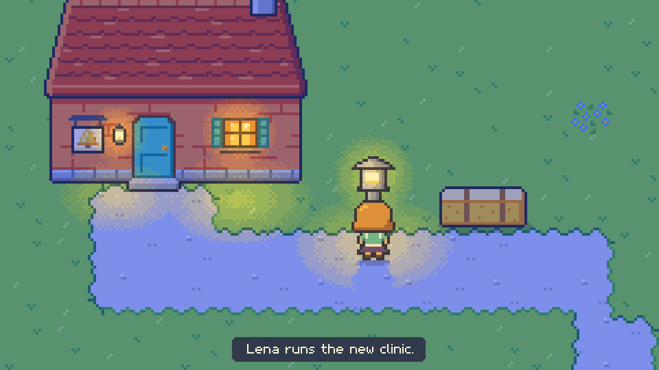

# Making art

This page shows how to add to the world: a townsperson, a building, a prop drawn by hand, a prop that glows, and a new kind of ground.
Each section has a sample that runs; all of them come together in one scene at the end.
Read [the art direction](STYLE.md) before you draw anything: it fixes the palette, the outline, the light and the proportions, and everything here follows it.

## Where new art goes

Everything Simutown can draw lives in one registry, `art` (`src/art/index.ts`), with four tables: `characters`, `props`, `terrain` and `emotes`.
Scenes, towns, the CLI, the gallery and the player all read it.

There are two ways to add to it:

- **For one scene or a few**, make the art in a file of your own and register it at run time: `art.characters.lena = lena`. The scene imports that file before it uses the new id. This is what the samples on this page do.
- **Without touching the built-in registry**, build your own (`const mine = { ...art, characters: { ...art.characters, lena } }`) and pass it to both `defineTown(spec, mine)` and `scene({ ..., art: mine }, ...)`. The film, the stills and the player all draw the scene with the art it was built with.
- **For good**, add it to the built-in art under `src/art/`: a person to the cast in `src/art/characters/index.ts`, a building spec to `src/art/buildings/presets.ts`, a prop to `src/art/street/` or `src/art/nature/`, a ground to `src/art/terrain/`. Then `pnpm sheet` draws it and `pnpm check` tests its size and anchor (`test/art-contract.test.ts`).

`scene()` and `defineTown()` take an `art` option of their own, but only to check names: the renderers of the CLI and the gallery always draw from the shared registry.
Art that is passed that way and not registered builds without an error and is then skipped, with a warning such as `simutown render: unknown character "lena" skipped`.
Register it, and pick ids that no built-in art uses.

## A new townsperson

`makeCharacter` builds a person from named choices.
Only `id`, `name`, `skin`, `head` and `top` are required.

```ts
// examples/art/lena.ts - a new townsperson from named choices.
import { art, makeCharacter } from 'simutown';

export const lena = makeCharacter({
  id: 'lena',
  name: 'Lena',
  skin: 'b',
  head: 'bob',
  hair: 'ginger',
  top: { kind: 'apron', color: 'teal' },
  bottom: { kind: 'skirt', color: 'indigo' },
  accessories: { glasses: true },
});

// Register her in the built-in registry, so that scenes, the CLI and the gallery can all use her.
art.characters.lena = lena;
```

The result has four directions, a 2-frame idle, a 4-frame walk, and the poses `sit`, `wave`, `talk` and `carry`.
This prints every choice:

```bash
pnpm tsx -e "import { CHARACTER_OPTIONS } from './src'; console.log(CHARACTER_OPTIONS)"
```

| Option | Choices |
|---|---|
| `body` | `adult` (default), `broad`, `child`, `elder` (stooped; add a cane) |
| `skin` | `a` light, `b` medium, `c` dark |
| `head` | `short`, `flattop`, `quiff`, `bowl`, `bob`, `long`, `bun`, `ponytail`, `braids`, `curls`, `spiky`, `bald`, `balding` |
| `hair` | `brown` (default), `black`, `white`, `blond`, `ginger` |
| `hat` | `{ kind, color? }`, kind one of `straw-hat`, `cap`, `beret`, `headscarf`, `chef-hat` |
| `beard` | `true` for a small chin tuft in the hair colour |
| `top` | `{ kind, color, sleeves?, apron? }`, kind one of `shirt`, `sweater`, `apron`, `coat`, `dress`, `overalls`, `uniform` |
| `bottom` | `{ kind, color }`, kind one of `trousers` (default, navy), `skirt`, `shorts`; leave it out with a dress |
| `shoes`, `accent` | a colour; the accent is the one small touch of colour (a ribbon, a hat band, a collar) |
| `accessories` | `{ glasses?, scarf?, bag?, cane? }`; scarf and bag take a colour |

Colours are `red`, `orange`, `yellow`, `green`, `teal`, `blue`, `purple`, `pink`, `white`, `cream`, `grey`, `slate`, `brown`, `tan`, `navy`, `indigo`, `maroon` and `charcoal`.
A wrong choice throws an error that lists the valid ones, for example `makeCharacter("x"): unknown head "mohawk". Valid: short, flattop, ...`.

Follow the People rules of [the art direction](STYLE.md#people): start from a silhouette nobody in the cast has (a hat, a hair shape, a coat), give the top one strong colour and the legs another, keep the ground colours out of clothes, and keep all three skin tones in the cast.
To make the person part of the built-in cast, add an entry to `CAST` in `src/art/characters/index.ts`, with a role and a one-sentence description: that is what scene authors cast from.

## A new building

`makeBuilding` assembles a building from the kit's approved parts.
Only `id`, `width` and `door` are required.

```ts
// examples/art/clinic.ts - a new building from a spec.
import { art, makeBuilding } from 'simutown';

export const clinic = makeBuilding({
  id: 'clinic',
  width: 6,
  wall: 'brick',
  roof: { form: 'hip', color: 'red' },
  door: { at: 2.5, style: 'panelled', paint: 'teal', lantern: 'left', step: true },
  windows: [{ at: 4.5, shutters: 'teal', lit: 'curtains' }],
  sign: { icon: 'bell', at: 1 },
});

art.props.clinic = clinic;
```

Positions are in tiles from the building's left edge to the centre of the piece.
A single door stands on one tile, so its `at` is a half: `2.5` is the middle of the third tile.
The result is a complete prop: the day sprite, the lit windows for dusk, the lights, a footprint, and a `door` place in front of the door, so a town exposes `clinic.door` and actors can `enter('clinic')`.

| Option | Choices |
|---|---|
| `width` | 3 to 10 tiles |
| `storeys` | `1` (default) or `2` |
| `wall` | `plaster` (default), `yellow`, `timber`, `brick`, `stone`, `planks` |
| `roof` | `{ form?, color?, height? }`: form `gable` or `hip`, colour `red`, `orange`, `blue` |
| `door` | `{ at, style?, paint?, lantern?, step? }`: style `plain`, `panelled`, `double`, `shop`; paint `red`, `wood`, `blue`, `teal`, `plum`, `green`; lantern `left`, `right`, `both` |
| `windows`, `upperWindows` | `{ at, kind?, shutters?, box?, lit? }`: kind `four-pane`, `tall`, `shop`, `round`; shutters `teal`, `plum`; lit `warm`, `curtains`, `dark` |
| `chimney` | `true`, `false` or a position right of the middle |
| `dormers` | positions of round attic windows |
| `turret` | `bell` (a school) or `clock` (the hall) |
| `awning` | `red`, `teal`, `plum`, `blue`, or `{ color, from, to }` |
| `sign` | `{ icon, at, storey? }`: icon `cup`, `loaf`, `book`, `letter`, `bell`, `scissors`, `basket`, `key` |
| `clock` | the position of a clock face on the top storey |

The full spec, with every rule, is `BuildingSpec` in `src/art/buildings/spec.ts`, and the built-in buildings in `src/art/buildings/presets.ts` are a dozen worked specs.
A spec that breaks a rule throws an error that says what to change, for example `a single door stands on one tile so that people line up with it: "door.at" must be one of 1.5, 2.5, ...`.
Vary width, storeys, roof, wall and where the door sits from one building to the next, so a street does not look like copies.

## A sprite as a text grid

Anything the kits cannot make is drawn by hand, as a text grid.
Each character is one pixel; each letter stands for a palette slot, `.` is transparent, and spaces and indentation are ignored.
The letters are in `docs/style/palette.png`, in red beside each swatch, and in `LEGEND` (`src/core/sprite.ts`): `0` is ink, `r q p o` the ochre ramp from light to dark, `v` a mid wood, and so on.

```ts
// examples/art/hay-bale.ts - a prop drawn as a text grid, with a footprint.
import { art, type PropDef, sprite } from 'simutown';

// One character per pixel, one letter per palette slot (docs/style/palette.png):
// 0 ink, r q p the ochre ramp from light to dark, v wood for the twine, . transparent.
// The top plane is lit (r), the front face takes the base tone (q), the right end is in shade (p).
const bale = sprite(
  `
  ..0000000000000000000000000000..
  .0rrrrrrrvvrrrrrrrrrrrvvrrrrrr0.
  0rrrrrrrrvvrrrrrrrrrrrvvrrrrrrp0
  0rrrrrrrrvvrrrrrrrrrrrvvrrrrrrp0
  0rrrrrrrrvvrrrrrrrrrrrvvrrrrrrp0
  0pppppppppppppppppppppppppppppp0
  0qqqqqqqqvvqqqqqqqqqqqvvqqqqqpp0
  0qqpqqqqqvvqqqqpqqqqqqvvqqqqqpp0
  0qqqqqqqqvvqqqqqqqqqqqvvqpqqqpp0
  0qqqqqpqqvvqqqqqqqqpqqvvqqqqqpp0
  0qqqqqqqqvvqqqqqqqqqqqvvqqqqqpp0
  0qpqqqqqqvvqqqpqqqqqqqvvqqqqqpp0
  0qqqqqqqqvvqqqqqqqqqqqvvqqqpqpp0
  0pppppppppppppppppppppppppppppp0
  .000000000000000000000000000000.
`,
  // The anchor is the bottom-left corner: it lands on the bottom-left corner of the origin tile.
  { anchor: [0, 15] },
);

export const hayBale: PropDef = {
  id: 'hay-bale',
  sprite: bale,
  // Two tiles wide and one deep are solid, growing right and up from the origin tile.
  footprint: { w: 2, h: 1 },
};

art.props['hay-bale'] = hayBale;
```

The rules that matter most, all from [the art direction](STYLE.md):

- A closed 1-pixel ink outline around a standing prop, with the corners rounded off; no ink at all on ground and flat props.
- Light from the upper left: the top and left take the light tone, the right and bottom the shade.
- Three tones of a ramp at most, flat colour, no dithering.
- A prop below eye level shows its top, a third to a half as deep as its front.
- Never `moss.2` or `cream.1` as the main colour: those two are the ground.

## A prop with a footprint

A prop's sprite is anchored at its bottom-left corner, `[0, h]`, and that point lands on the bottom-left corner of its origin tile; the sprite rises above the tile.
Its `footprint` is the ground it covers, `w` tiles wide and `h` deep, growing right and up from the origin tile: nobody can walk there.
The footprint covers only what stands on the ground: a tree is solid only at its trunk and people walk behind its canopy.

The hay bale above is two tiles wide and one deep.
A prop with no footprint is walked through; set `flat: true` for things on the ground, such as flowers or a rug, so that they are drawn under people.

## Places, an emissive layer and a light

This stone lantern shows the other parts of a prop.

```ts
// examples/art/stone-lantern.ts - a prop with a place to stand, an emissive layer and a light.
import { art, type PropDef, sprite } from 'simutown';

// By day the glass is frosted cream (c, b) with one white glint (5).
const lanternArt = `
  ......0000......
  ....00433200....
  ..004444333200..
  .04444443333320.
  0000000000000000
  ...0444443320...
  ...04cc5cc320...
  ...04ccccc320...
  ...04ccccc320...
  ...04bbbbb320...
  ...0444443320...
  ..004444333200..
  ..000000000000..
  .....043320.....
  .....043320.....
  .....043320.....
  .....043320.....
  .....043320.....
  .....043320.....
  .....043320.....
  .....043320.....
  ....04443320....
  ...0444433320...
  ...0333333220...
  ...0222222220...
  ...0000000000...
`;

// The emissive layer has the same size and anchor and repaints only the glass, in lamplight.
// Everything else becomes transparent, so the frame reads dark against the glow.
const glowArt = lanternArt.replace(/[0234]/g, '.').replace(/[c5]/g, 'r').replace(/b/g, 'q');

export const stoneLantern: PropDef = {
  id: 'stone-lantern',
  sprite: sprite(lanternArt, { anchor: [0, 26] }),
  emissive: sprite(glowArt, { anchor: [0, 26] }),
  footprint: { w: 1, h: 1 },
  // A light at the centre of the glass, in pixels from the anchor (up is negative).
  lights: [{ dx: 8, dy: -19, radius: 30, flicker: 0.15 }],
  // A walkable tile one below the origin tile: towns expose it as "<id>.front".
  places: { front: { dx: 0, dy: 1 } },
};

art.props['stone-lantern'] = stoneLantern;
```

- **`places`** are named walkable tiles, in tiles from the origin tile (`dy` is positive going down the screen). A town exposes them as `<id>.<place>`, here `stone-lantern.front`, and scripts walk there. A prop that people can go into needs a `door` place.
- **`emissive`** is drawn on top once the lamps come on, around half past five in the evening, and stays bright while the frame darkens. It has the size and anchor of the sprite, and it repaints only what glows: glass in `ochre.2` with an `ochre.3` core. Frames and bars stay out of it, so they read dark against the light.
- **`lights`** pool lamplight on the ground and on nearby people at dusk and at night. `dx` and `dy` are pixels from the anchor; `ground: false` keeps the glow at its source, as for an upstairs window.

## A new kind of ground

A ground is a `TerrainDef`: a few 16 x 16 tile variants, a priority, and a fringe, the edge it draws on lower-priority neighbours.

```ts
// examples/art/gravel.ts - a new ground: tile variants, a priority and a fringe.
import { art, ground, sprite, straightEdge, type TerrainDef } from 'simutown';

// Marks are tiny sprites stamped on a flat base colour; no ink on terrain.
const pebble = sprite(`
  .5.
  433
`);
const grit = sprite(`
  3.3
`);

// Four variants whose marks sit on different rows and columns, so a large area shows no grid.
// The renderer picks one per tile from its position.
const looks = [
  ground('steel.4', [pebble, 3, 3], [grit, 10, 11]),
  ground('steel.4', [grit, 6, 6]),
  ground('steel.4', [pebble, 11, 1], [grit, 1, 13]),
  ground('steel.4'),
];

export const gravel: TerrainDef = {
  id: 'gravel',
  variants: looks,
  // Above cobble (1) and dirt (0), below grass (4): grass creeps over gravel with its turf
  // edge, and gravel draws its own edge on cobble and dirt.
  priority: 1.5,
  // A straight border, pale on the lit sides (north, west) and slate on the shaded ones.
  fringe: straightEdge('steel.5', 'steel.3'),
};

art.terrain.gravel = gravel;
```

How edges work: where two grounds meet, the one with the higher priority draws its fringe on the tile of the other.
`fringe.n` is drawn on the neighbour to the north, so it shows this ground creeping in from that tile's south edge; corner keys (`ne`, `in-ne`, ...) round the corners.
Simutown exports helpers for the common edges: `straightEdge` (a kerb or a deck's edge), `driftEdge` (sand), and `recolorFringe(turf, ...)` (the turf edge in other colours); `ground` stamps marks on a flat tile.
The priorities of the built-in grounds, and which of them may touch, are in [the art direction](STYLE.md#which-grounds-may-touch); a new ground must say where it joins that table.
Use it in a town by giving it a character in the legend: `legend: { ':': 'gravel' }`.

## A room

The inside of a building is a town of its own, built with `defineTown` from the interior kit (`src/art/interior/`).
Floors and walls are terrain, so the room's shape is the ASCII map; everything else is a prop.

```text
################     #  ink: the dark outside, solid; the wooden cap is drawn on it
#PPPPPPPPPPPPPP#     P  wall-paper: the upper row of the back wall
#pppppppppppppp#     p  wall-paper-base: the base row, with a wainscot down to the floor
#..............#     .  floor-pine
#..............#
#..............#
#..............#
#..............#
################
```

```ts
const home = defineTown({
  name: 'home',
  terrain: map, // the map above
  legend: { '#': 'ink', P: 'wall-paper', p: 'wall-paper-base', '.': 'floor-pine' },
  props: [
    { kind: 'window-wide', at: [4, 2] }, // on the wall: stands on the base row
    { kind: 'fireplace', at: [7, 3] },   // against the wall: on the first floor row
    { kind: 'chair', at: [4, 5] },
    { kind: 'table', at: [4, 6] },
    { kind: 'chair-back', at: [5, 7] },
    { kind: 'doormat', at: [8, 7] },     // the exit, on the bottom floor row
  ],
  places: { door: [8, 7] },
});
```

- **The shell.** Draw the room as a rectangle of wall and floor inside a border of `ink`, at most 14 x 7 tiles (two rows of wall, up to five of floor), so the whole box and its cap show at zoom 2. The back wall is two rows: an upper `wall-<look>` over a base `wall-<look>-base`. The looks are `plaster`, `paper`, `stripe`, `panel` and `brick`, and any upper row goes with any base row. The floors are `floor-pine`, `floor-wood`, `floor-checker` and `floor-stone`.
- **The cap.** Every floor and wall draws the top of the walls as its fringe on the ink around it, so the cap lies outside the room, where furniture cannot cover it. There are no corner or side pieces to place, and nothing to keep clear of the walls.
- **Wall pieces** (`window`, `window-wide`, `wall-lamp`, `picture`, `picture-flowers`, `wall-clock`, `wall-shelf`, `menu-board`, `blackboard`, `banner`, `inner-door`) stand on the base row of the wall and cover the wall above it. They have no footprint.
- **Furniture** stands on the floor. Tall pieces (`wardrobe`, `bookshelf`, `bread-rack`, `fireplace`, `oven`, `kitchen-counter`) go on the first floor row, against the wall.
- **Counters** (`bakery-counter`, `bar-counter`, `shop-counter`, `post-counter`) are three tiles wide with a `behind` place for the shopkeeper and a `front` place for the customer, so leave the floor row above them free.
- **Seats.** `chair`, `stool`, `armchair` and `sofa` (seats `left` and `right`) face the viewer; `chair-back` is a chair seen from behind, for the near side of a table; `cafe-chair` and `cafe-chair-left` face right and left; `bar-stool` faces the bar, away from the viewer. Scenes use them with `actor.sitOn(prop)`. Tables have no places, so chairs can stand on any side.
- **The exit** is a `doormat` on the bottom floor row and a place called `door` on the same tile.

The rooms of Willow Square (`src/towns/willow-square-rooms.ts`) are built this way. `pnpm tsx tools/interior-preview.ts` puts two or three townsfolk in each of them with a tiny scene and renders it at noon and at 21:00, and `pnpm sheet interior` draws every piece of the kit.

## All together

This scene imports the five files above, which registers them, and uses them in a small town from afternoon into dusk.

```ts
// examples/new-art.ts (excerpt)
import './art/lena';
import './art/clinic';
import './art/hay-bale';
import './art/stone-lantern';
import './art/gravel';
import { defineTown, scene } from 'simutown';
```



The whole file is [`examples/new-art.ts`](../examples/new-art.ts).

## Review what you made

A sprite you have not looked at is not done.

- **In a scene.** `pnpm simutown still examples/new-art.ts -t 3` renders a frame by day and `-t 9` one at dusk; open the PNG and look at the new art at x4, beside the built-in art. Check the dusk frame for anything that glows.
- **On a contact sheet.** `pnpm sheet <group>` draws all the built-in art of a group (`terrain`, `nature`, `street`, `buildings`, `characters`, `ui`, `interior` or `all`) to `out/sheets/<group>.png`, with every frame of every character and the lit version of anything with an emissive layer beside its day look. `--only <text>` keeps the cells whose label contains the text, and `--scale <n>` zooms. It shows built-in art, so use it once the art is in `src/art/`.
- **In the Atlas.** `pnpm dev`, then Atlas in the menu, shows every character, prop, ground and emote in the registry, animated, with the ids to type. Art registered by a scene in `scenes/` appears there too, once the gallery has loaded that scene (restart `pnpm dev` after adding a file).
- **Against the style key.** `docs/style/stylekey.png` shows the reference art in context; put yours beside it and judge it at x4, from across the room. The checklist at the end of [the art direction](STYLE.md#checklist-before-you-call-a-sprite-done) is the definition of done.

After changing built-in art that appears in the style key, regenerate the pictures with `pnpm tsx tools/stylekey.ts` and look at them.
